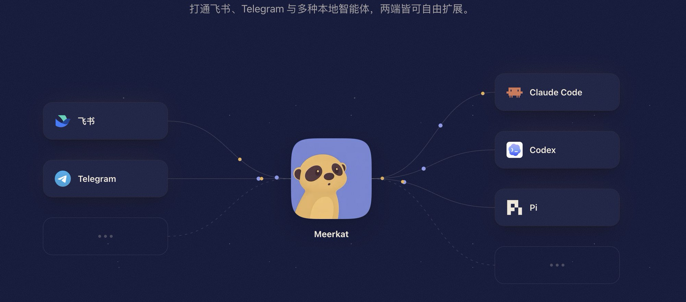

<div align="center">

# Meerkat

**Dispatch and collaborate with local AI agents directly inside Feishu & Telegram.**

Chat 1-on-1 or collaborate in groups · Ready out of the box · 100% private & local

<p align="center">
  <a href="https://meerkat.shens.dev">Website</a> •
  <a href="https://github.com/what1f/meerkat/releases/latest">Download for macOS</a> •
  <a href="README.zh-CN.md">简体中文</a>
</p>

[](LICENSE)
[](https://github.com/what1f/meerkat/releases)
[](https://github.com/what1f/meerkat/releases)

<br /><br />



</div>

<br />

Meerkat connects your messaging apps (Feishu, Telegram) with locally installed AI agents (Claude Code, Codex, Pi). Instead of constantly switching terminal windows, you can dispatch tasks, collaborate on code, and receive progress reports directly inside your chat.

## Features

- **Ready out of the box**: No servers to deploy, no configs to write. Scan a QR code to connect and start in minutes.
- **Local agents ready to work**: Seamlessly bring Claude Code, Codex, and Pi into your daily messaging workspace.
- **1-on-1 DMs & group collaboration**: Chat directly with an agent or invite them into group channels to split tasks and ship code together.
- **100% private and local**: Your code, credentials, and conversation history never leave your machine.
- **Multi-device orchestration**: Coordinate agents across multiple Macs and workstations in one unified team.

## Quick Start

1. **Download**: Grab the latest `.dmg` from [Releases](https://github.com/what1f/meerkat/releases/latest) (or build locally from source below) and move `Meerkat.app` to Applications.
2. **Connect**: Launch Meerkat and scan the QR code with Feishu (or connect via Telegram).
3. **Start Collaborating**: Pick an installed local agent, name it, and message them directly or mention `@them` in chat.

## Build from Source

Prerequisites on macOS: Rust (`1.96.0`, managed via `rust-toolchain.toml`), [just](https://github.com/casey/just), [pnpm](https://pnpm.io/), and [Zig](https://ziglang.org/download/) (`0.17`, for building the built-in `meerkat-agent` binary).

```bash
just dev    # build local services + built-in agent and launch the desktop app
just check  # format, build, web lint, open-source & boundary checks
just test   # run hermetic module-level E2E scenarios
just app    # build release Meerkat.app
```

## Supported Integrations

| Messaging Apps | Local Agents | Platform |
| :--- | :--- | :--- |
| Feishu (飞书), Telegram | Claude Code, Codex, Pi | macOS |

## Contributing

See [CONTRIBUTING.md](CONTRIBUTING.md) for local development setup, testing, and guidelines.

## License

[Apache 2.0 License](LICENSE)
