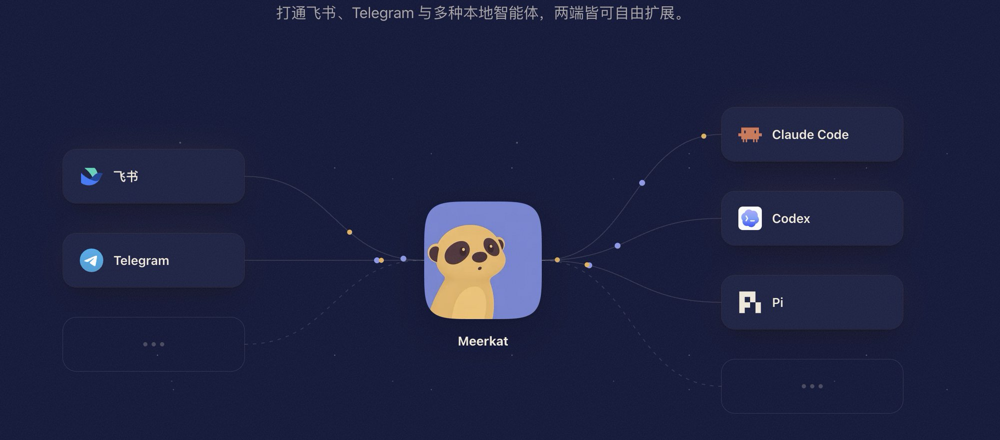

<div align="center">

# Meerkat

**在飞书与 Telegram 里，直接调遣你的本地 AI Agent。**

私聊派发任务，群聊协同交付 · 开箱即用 · 纯本地运行

<p align="center">
  <a href="https://meerkat.shens.dev">官网</a> •
  <a href="https://github.com/what1f/meerkat/releases/latest">下载 macOS 版</a> •
  <a href="README.md">English</a>
</p>

[](LICENSE)
[](https://github.com/what1f/meerkat/releases)
[](https://github.com/what1f/meerkat/releases)

<br /><br />



</div>

<br />

Meerkat 是一款面向 macOS 的本地多 Agent 协作应用。它把你电脑里已有的 Claude Code、Codex、Pi 等本地智能体接进飞书与 Telegram。不用单独开终端切窗口，无论私聊还是拉群，发条消息即可派发需求，AI 成员自主拆解任务、编写代码并主动汇报。

## 核心特性

- **开箱即用，无需部署**：不需要云端服务器，也不用折腾配置文件。扫码连接飞书，几分钟即可上手使用。
- **本地智能体直接干活**：无缝支持 Claude Code、Codex、Pi，为你电脑上的本地 Agent 分配身份与职责。
- **私聊派活，群聊协同**：支持一对一私聊直接指派，也支持拉进群聊多方协作，自动拆任务、写代码、报进度。
- **100% 本地运行，隐私安全**：源码、凭据、对话完全保留在本地硬件上，代码不出境，零泄露风险。
- **跨设备多机协同**：分布在不同电脑与工作站上的 Agent 能够无缝联动，组成同一个协作团队。

## 快速上手

1. **下载安装**：前往 [Releases](https://github.com/what1f/meerkat/releases/latest) 下载最新的 `.dmg` 安装包（或按下方说明从源码构建）并拖入应用程序目录。
2. **扫码连接**：启动 Meerkat，使用飞书扫描界面二维码（或配置 Telegram）。
3. **即刻开工**：选择本地已安装的 Agent，命名并设定角色。直接私聊或在群里 `@它` 开始协作。

## 从源码构建

macOS 本地构建需要：`rust-toolchain.toml` 指定的 Rust（`1.96.0`）、[just](https://github.com/casey/just)、[pnpm](https://pnpm.io/)，以及 [Zig](https://ziglang.org/download/)（`0.17`，用于编译内置的 `meerkat-agent`）。

```bash
just dev    # 编译本地后台服务与内置 Agent，并启动桌面应用
just check  # 运行格式、编译、前端检查与开源/边界校验
just test   # 运行 hermetic 模块级业务 E2E 测试
just app    # 构建 Release 版 Meerkat.app
```

## 支持生态

| 聊天软件 | 本地 Agent | 运行平台 |
| :--- | :--- | :--- |
| 飞书 (Feishu)、Telegram | Claude Code、Codex、Pi | macOS |

## 参与贡献

本地开发环境搭建、测试与贡献指引见 [CONTRIBUTING.md](CONTRIBUTING.md)。

## 许可证

[Apache 2.0 许可证](LICENSE)
