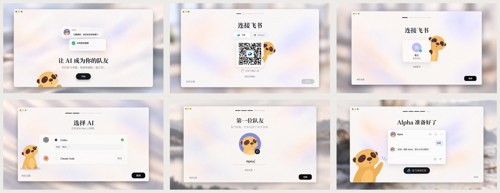

# Onboarding

## User story

A person who has never heard of Lankide installs it because someone said "it
puts AI members into our Feishu". On first launch they think:

1. What does this give me, and what do I do first? One sentence, one button.
   No "workspace", "Agent", "Harness", or "App".
2. Where does my team chat? Feishu. Pick it.
3. Authorize? Scanning a QR code is fine, once.
4. Where does the AI run? It should find Codex or Claude Code on this Mac
   and prove it works. If nothing is installed, say what to install.
5. Name the first member. Everything else has a default.
6. Show me it works: open Feishu, say hello, get a reply.
7. Only now: more members, tasks, machines, models.

Principles:

- Show the result before explaining concepts.
- One question per screen, answerable by a newcomer.
- The finish line is the first reply in Feishu, not "created successfully".
- Every non-blocking step offers **稍后设置**. Skipped steps reappear as
  pending cards in the main window. Skipping a step also skips the steps that
  depend on it (skipping Connect skips First member).
- Nothing waits forever. Every failure shows one actionable next step.

## Flow

The interactive version is the 引导 section of [system.html](system.html#onboarding);
it supersedes the mockups below where they disagree.

Welcome and Ready happen at the member's desk, on the plain floor of the 工区
page. The setup steps in between happen on the pegboard of the main window:
its holes fade in, and each step hangs one object on it. The layout follows
that object. The footer is the only fixed
region: **稍后设置** at bottom-left, the primary pill at bottom-right. Four
hairline dashes at the top show progress after Welcome.

| Step | Hero | Mockup |
|---|---|---|
| Welcome | A desk with a member at work, a Feishu chat beside it, a task ticked off | [1](onboarding/1-welcome.jpg) |
| Connect | QR code hanging as a paper tag; flips into your own badge in place | [2](onboarding/2-connect.jpg), [3](onboarding/3-signed-in.jpg) |
| Choose AI | The member console; its screen lists the AI found on this Mac | [4](onboarding/4-choose-ai.jpg) |
| First member | Your badge and the new member's blank badge side by side | [5](onboarding/5-member.jpg) |
| Ready | The new member's desk and the direct chat | [6](onboarding/6-ready.jpg) |

### Welcome

Title 「让 AI 成为团队成员」, one secondary line, **开始**. No footer, no
progress.

### Connect

- Segmented 飞书 / Telegram. Telegram is described in [Telegram](#telegram).
- QR states: waiting (spinner caption), scanned (QR dims, user avatar with a
  check, 「在手机上确认」), signed in (the tag flips into the user's badge,
  **切换账号** under it), expired (refresh button on the QR itself, no error
  banner).
- Feishu requires this one sign-in: it identifies who leads the team, owns
  the tasklist, and appears on the board. The earlier 每次手动确认 mode is
  dropped; it still needed a scan per member and only avoided storing the
  session. Sign-in is always kept; there is no option. Lankide stores the Feishu web
  session (encrypted in the workspace secrets) and creates every member's App
  through the developer console. The team tasklist is created as the user and
  owned by them.
- When the stored session expires, the next member creation asks for the QR
  again inline.
- The workspace is created from the signed-in tenant name. No user-facing
  workspace ID.

### Choose AI

- The member console hangs on the board with its figure on top; its screen
  lists the AI found on this Mac.
- The selected AI is tested once automatically: a spinner, then a green or
  red LED. A passing test types the reply under the row. Timeout 30 s, no
  retry, never blocks **继续**. Clicking a red LED reveals the reason.
- One AI found: skip the screen. None found: the screen says so and lists
  what to install.

### First member

- Only the name, typed on the blank badge. The avatar is a random built-in
  meerkat not used by another member; clicking it opens the avatar picker.
- **高级设置** hangs the member console beside the badge: the screen opens
  the machine, AI, model, and thinking picker, and the personality card sits
  below it.
- **创建** (or Enter) shows progress on the badge itself. If the developer
  console fails, a QR tag hangs next to the badge with
  「用飞书扫一扫，确认创建」 (PersonalAgent flow; the tasklist is then created
  by the App and transferred to the user).

### Ready

- Title 「{name} 准备好了」, the member's desk, and **在飞书中打开**, which
  opens the direct chat.
- Lankide waits for the first message: the member types, then the reply
  appears in the chat. Until then **完成** is a quiet link; after the reply it
  becomes the primary pill and enters the main window, where the new badge
  hangs on the board.

## Telegram

Same steps and objects; the differences come from what Telegram allows
(research: Bot API up to 10.3, 2026-08).

- **Connect** is the token tag only: the user creates one bot in @BotFather,
  turns on Bot Management, and pastes its token; one hint line under the tag
  says exactly that. A valid token shows the bot's handle with a dot. There is
  no pairing scan: a `/start` link only yields the user's ID and name and lets
  the bot message them, and the first member's confirmation already carries
  that identity (`ManagedBotUpdated.user`).
- **First member** always ends with a confirm QR (Managed Bots): Telegram has
  no way to create a bot without the owner confirming it. Same QR tag as the
  Feishu fallback, captioned 「用 Telegram 扫一扫，确认创建」. Until then your
  badge is blank; confirming flips it into your badge (name and photo from
  Telegram, default avatar when the photo is hidden). If this step is skipped,
  your badge appears with the first member added later.
- **Ready** opens the member's chat in Telegram. The user taps Start there;
  the step completes on the first real reply.
- **Not offered:** team tasklist, automatic group setup (the user adds bots to
  their own groups), streaming replies (not used on any provider).
- **Read reaction:** each provider supplies its own reaction list; Telegram's
  is its fixed emoji catalog.
- **Delete:** Telegram cannot delete a bot through any API. Removing a member
  stops it, revokes its token, and the confirmation says the account can be
  deleted for good in @BotFather.

## Adding members later

No dialog: the empty peg on the members board brings a blank badge forward
with a random avatar; type the name and press Enter or **添加**. The badge
hangs back on the board and shows creation progress in place. The old
four-step wizard is removed. A QR appears inline only when the stored session
has expired or the developer console fails.

## You

The signed-in user hangs on the members board like everyone else, on a
periwinkle brand lanyard instead of black (no label, no other styling), and
can be reordered, but is not edited in Lankide: name, photo, and role come
from the chat app. Clicking the badge flips it over; the back shows only the
chat app mark (no organization name, on any provider) and two tear-off rows,
**同步资料** and **切换账号**. Clicking anywhere else flips it back. It cannot
be deleted.

## Avatars

- Built-in set: the logo meerkat plus 16 variations (background, accessory,
  pose, activity), flat style matching the logo.
- The picker shows **上传** first, then the built-in set.
- New members get a random built-in avatar not used in the workspace.
- The same image is set as the Feishu App icon.

## Implementation plan

1. Design system groundwork from [design-system.md](design-system.md):
   tokens, status colors, typography, and the new primitives.
2. Onboarding scaffold and the Connect step, including the two Feishu modes.
3. Choose AI: detection and the inline test.
4. First member: avatar picker and built-in avatars.
5. Ready: open the direct chat and wait for the first reply.
6. Replace the add-member dialog and remove the old wizard.

Each step ends with `just check` and `just test` and its own commit.
